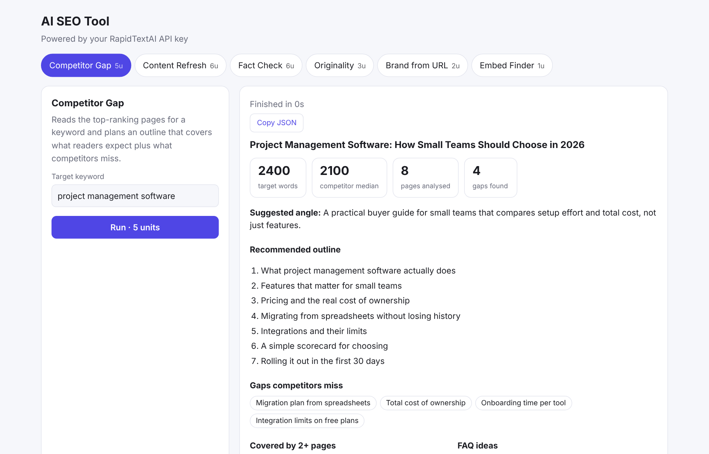
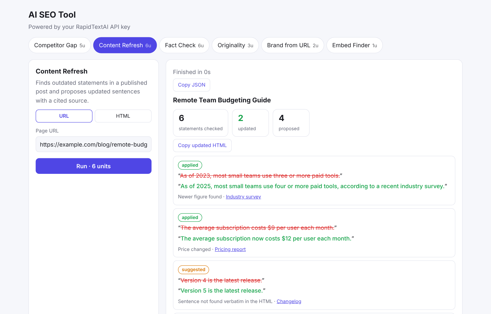
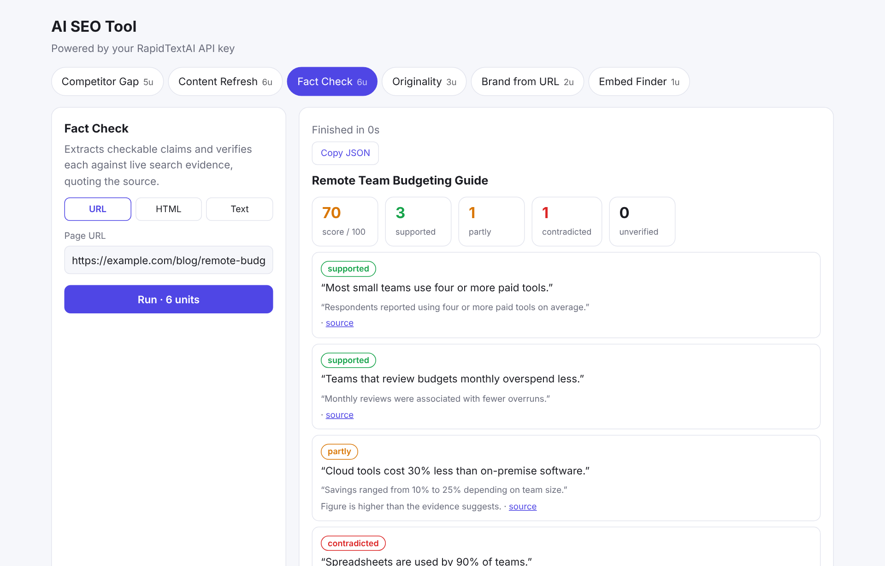
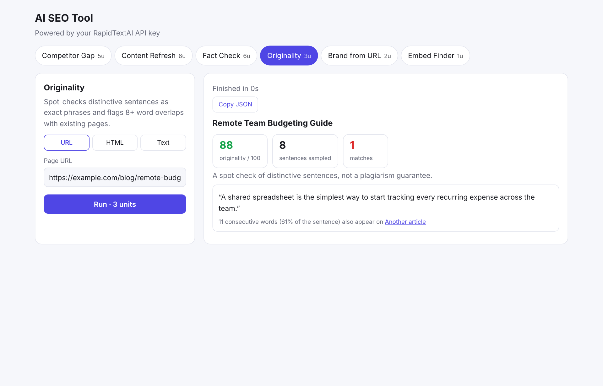

# AI SEO Tool

  

Six AI-powered SEO tools in one place, from your terminal or a local web page, using your own [RapidTextAI](https://app.rapidtextai.com) API key. No SaaS dashboard to log into, no extra subscriptions, nothing to install.



*Screenshots were captured in demo mode with sample data (see [Try it without a key](#try-it-without-a-key)).*

## Why use it

- **Write what actually ranks.** Competitor Gap reads the pages already ranking for your keyword and hands you a ready-to-use outline, target length and the topics competitors miss.
- **Keep old posts earning traffic.** Content Refresh finds stale statistics and years, proposes updated sentences with a cited source, and gives you the updated HTML.
- **Publish with confidence.** Fact Check verifies each claim against live search evidence and quotes where it found it. A verdict is only accepted if the quote really appears in the source, so it cannot invent support.
- **Catch copied text.** Originality spot-checks distinctive sentences as exact phrases and tells you which page shares 8+ consecutive words.
- **Stay on brand.** Brand from URL reads a website and drafts a voice, tone, audience and fact sheet you can reuse.
- **Richer pages.** Embed Finder suggests verified tweets and videos, each tied to the heading it belongs after.
- **Pay per use, no lock-in.** Each run costs a small number of RapidTextAI request units, and failed runs are refunded by the API. Everything runs on your machine.
- **Zero dependencies.** Plain Node.js. Reports save as Markdown and JSON, so they drop straight into docs, tickets or your CMS.

## The tools

| Tool | What you give it | What you get | Units |
|---|---|---|---|
| **Competitor Gap** | A keyword | Outline, target word count, common vs. missing topics, FAQ ideas, pages analysed | 5 |
| **Content Refresh** | A URL or HTML | Before/after sentence changes with source links, updated HTML | 6 |
| **Fact Check** | URL, HTML or text | Score out of 100, verdict per claim (supported, partly, contradicted, unverified) with quoted evidence | 6 |
| **Originality** | URL, HTML or text | Score out of 100 and the exact matches found | 3 |
| **Brand from URL** | A website URL | Suggested brand name, voice, tone, audience, CTA and facts | 2 |
| **Embed Finder** | Topic and headings | Verified tweets and videos to embed after each heading | 1 |

<table>
<tr>
<td width="50%"><br><sub>Content Refresh: outdated statements with proposed updates</sub></td>
<td width="50%"><br><sub>Fact Check: verdicts with quoted evidence</sub></td>
</tr>
<tr>
<td width="50%"><br><sub>Originality: overlapping text flagged by source</sub></td>
<td></td>
</tr>
</table>

## Requirements

- [Node.js](https://nodejs.org) 18 or newer
- A RapidTextAI account and API key (dashboard at <https://app.rapidtextai.com>)

## Install

```bash
git clone https://github.com/alisaleem252/ai-seo-tool.git
cd ai-seo-tool
cp .env.example .env        # Windows: copy .env.example .env
```

Open `.env` and paste your key:

```
RAPIDTEXTAI_API_KEY=your-api-key-here
```

There is nothing to `npm install`.

## Use it

### Web interface

```bash
npm start
```

Open <http://localhost:3000>, choose a tool, fill in the input and run it. Without a `.env` key, the page asks for your key and keeps it in your browser only. The server listens on `127.0.0.1`, so it is not exposed to your network.

### Command line

```bash
node bin/cli.js gap "project management software"
node bin/cli.js refresh https://yoursite.com/blog/old-post
node bin/cli.js fact-check https://yoursite.com/blog/post
node bin/cli.js originality --file draft.txt
node bin/cli.js brand https://yoursite.com
node bin/cli.js embeds --topic "remote team budgeting" -H "Why budgets fail" -H "Choosing a tool" --tweets --videos
node bin/cli.js capabilities          # which features your server has enabled
```

Each run prints a report and saves `.md` and `.json` files (plus `.updated.html` for Content Refresh) to `./output`. Useful flags: `-f/--file` to read a local `.html` or `.txt` file, `--json` for raw output, `--no-save`, `-o <dir>`, `-m <model>`. Run `node bin/cli.js --help` for everything. Optionally `npm link` to get an `ai-seo-tool` command.

### As a library

```js
import { SeoClient } from './src/client.js';

const seo = new SeoClient({ apiKey: process.env.RAPIDTEXTAI_API_KEY });
const gap = await seo.run('competitor-gap', { keyword: 'project management software' }, {
  onEvent: (e) => e.type === 'progress' && console.log(e.stage),
});
console.log(gap.outline.sections);
```

## Try it without a key

```bash
npm run demo
```

Starts the same web page against a fake API with canned sample data. No key needed and no units spent. This is how the screenshots above were made, so the numbers and text in them are examples, not real analysis.

## Good to know

- **One tool at a time per account.** A second request while one is running returns HTTP 429.
- **Needs web search on the server.** If the RapidTextAI server has no search configured, tools return 503. `capabilities` shows what is enabled.
- **Spot checks, not guarantees.** Originality samples distinctive sentences, and Fact Check examines up to 10 claims. Review results before publishing.
- **Public pages only.** The backend reads public pages (public IPs, robots.txt respected).

## Troubleshooting

| Message | Fix |
|---|---|
| `Missing API key` | Create `.env` from `.env.example`, or pass `--key`. |
| `401` | The key is wrong or revoked. Copy it again from your dashboard. |
| `429` | Another tool is running on your account. Wait for it to finish. |
| `503 search_unavailable` | Web search isn't configured on the server yet. |

## Development

```bash
npm test      # offline tests against a local mock server, no key needed
```

Layout: `src/tools.js` (tool definitions and input validation), `src/client.js` (API client and SSE parser), `src/report.js` (Markdown reports), `bin/cli.js`, `server.js` and `public/` (web UI), `test/mock-api.js` (demo API).

## API reference

Wraps the RapidTextAI v2 SEO endpoints at `https://app.rapidtextai.com/openai`: `POST /v2/seo/{competitor-gap | content-refresh | fact-check | originality | brand-from-url | embeds}` and `GET /v2/seo/capabilities`. Authentication is `Authorization: Bearer <key>`. Override the base URL with `RAPIDTEXTAI_BASE_URL`.
